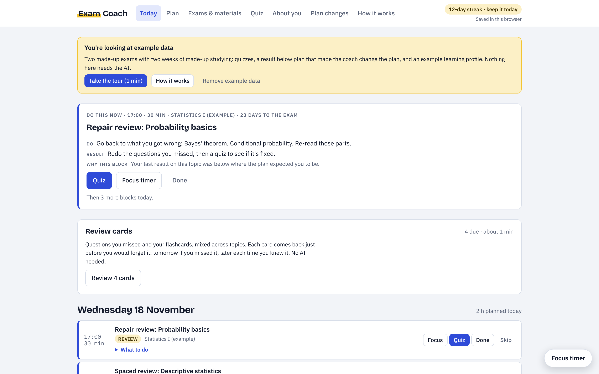
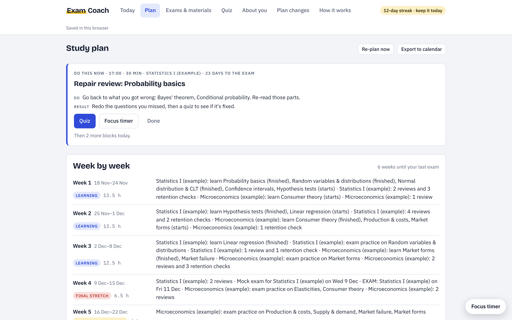
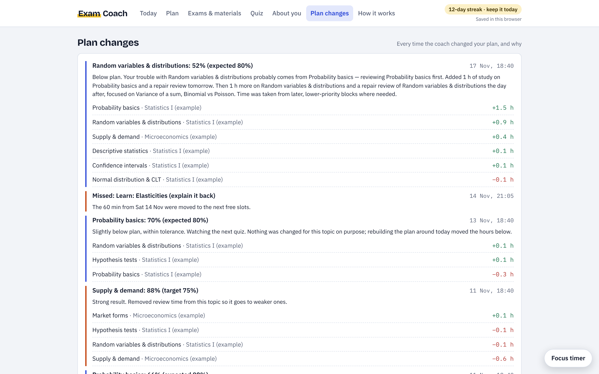
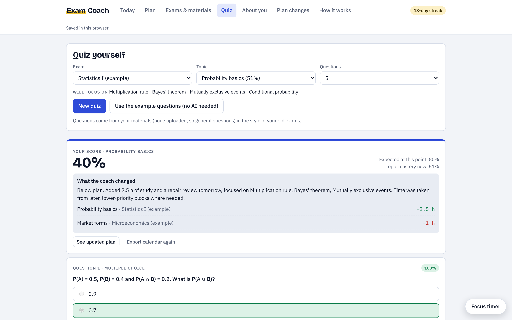
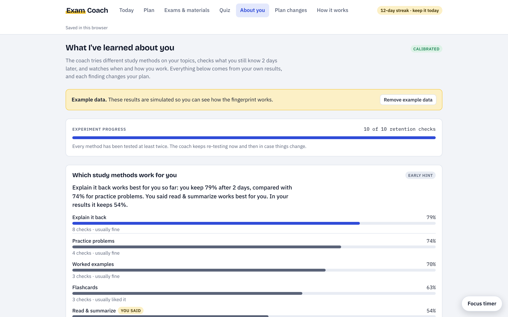
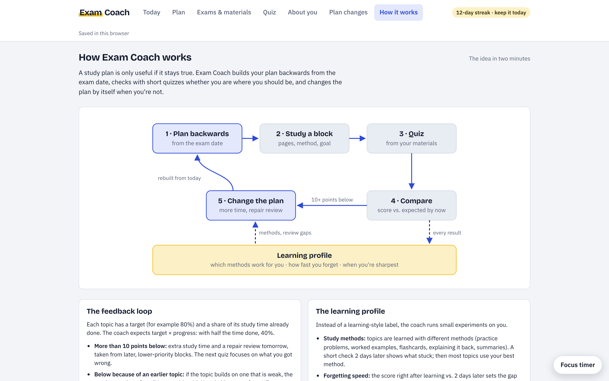
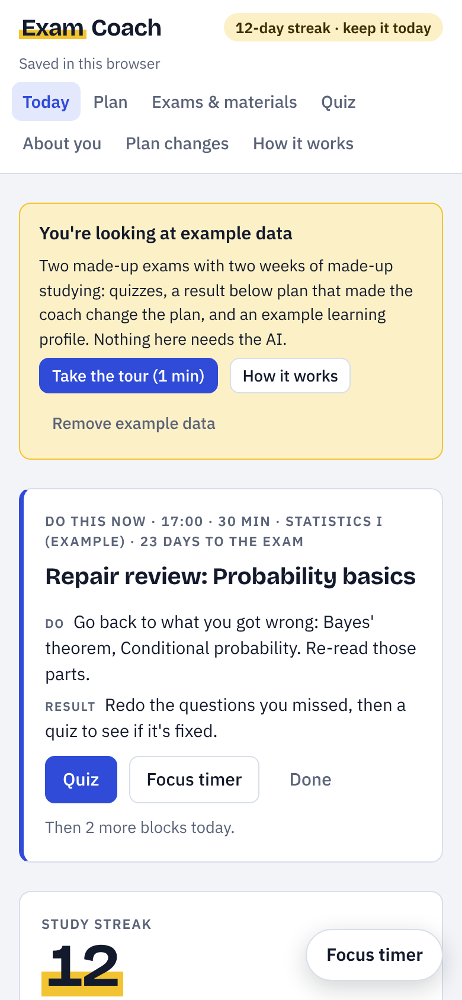

# Exam Coach

An AI study planner for university students. Upload your scripts, slides and old exams, enter your exam dates, and Exam Coach builds a study plan backwards from the exam. After each study block you take a short quiz. If you score below where the plan expects you to be, the plan changes by itself, and it tells you why.

Over time it also measures which study methods, times of day and session lengths work for you, instead of guessing from a learning-style label.

**Try it in one click:** open the site and press **Try it with example exams**. You get two made-up exams with two weeks of made-up history (quizzes, a result below plan that changed the plan, an example learning profile) and a 1-minute guided tour. The example needs no AI, so it also works offline from the AI or when the free quota is used up. **How it works** in the top bar explains the idea on one page.



## Why not just ask a chatbot?

A chatbot can write a plan once. It doesn't remember your quiz results, doesn't notice when you fall behind, and doesn't put spaced reviews into your week. Exam Coach uses an AI for the parts a chatbot is good at (reading your materials, writing questions, grading written answers) and does the rest itself:

| | Asking a chatbot | Exam Coach |
|---|---|---|
| Remembers your results | Only what you paste in again | Every block, quiz and mock exam, in your browser |
| Changes the plan | When you ask and explain what happened | By itself after every quiz, mock exam or missed block, with the reason |
| Spaced reviews | Can explain them | Schedules a 2-day retention check and later reviews for each topic |
| Low score | Sees one question | Checks what the topic builds on and repairs that first |
| Study methods | Guesses from your description | Measures what you still know 2 days later, per method |

## Features

- **Plan built backwards from the exam.** Final review the day before, a mock exam before that, then learning blocks and spaced reviews spread over the days you have. Topics that appear often in old exams get more time.
- **Reads your own materials.** Upload PDFs of scripts, slides and old exams, or add a whole course folder at once (in Chrome and Edge it stays connected, so new files can be added with one click). The AI turns them into a topic list with weights, estimated hours and page references, which you can edit. Formulas are shown with real symbols (α, Xᵢⱼ), not LaTeX code.
- **Quizzes in the style of your old exams.** Multiple choice, short answers and calculations, graded by the AI with feedback on what was missing.
- **A plan that adapts.** A low quiz score adds study time for that topic, schedules a review for the next day and focuses the next quiz on what you got wrong. If the topic builds on a weaker one, the repair goes there first ("Your trouble with X probably comes from Y"). Skipped blocks are rescheduled. Every change is logged with its reason under **Plan changes**.
- **Mock exams and a practice exam on all topics.** Enter points per task; each topic's result feeds the same loop.
- **Study sessions.** Each learning block opens a session made from your material: practice problems, worked examples, flashcards, or writing an explanation or summary that the AI checks.
- **Teach the AI and oral exam practice.** On the Study page you can explain a topic to the AI, which plays a curious classmate, asks follow-up questions and points out gaps against your material. Or practise a short oral exam: 3–5 examiner questions, one at a time, ending with a grade estimate on the Austrian 1–5 scale. Both count like a quiz. Answers can be typed, or spoken where the browser supports speech input.
- **Learning profile.** The app tries different study methods on different topics and checks two days later what you still remember. It also learns how fast you forget, when you're sharpest, how much of your plan you complete, how long you focus and whether your confidence can be trusted, and offers to adjust the plan to each finding.
- **Focus timer and streaks.** A Pomodoro timer that credits focus time to your study blocks, and a daily study streak.
- **Calendar export.** Download the plan as an `.ics` file for Google Calendar, Outlook or Apple Calendar.
- **Example data, guided tour, How it works.** A complete example with history, built-in example questions, a 6-step tour (keyboard: ← →, Enter, Esc) and a one-page explanation with a diagram.

| Plan, week by week | What the coach changed, and why |
|---|---|
|  |  |

| Quiz result | Learning profile |
|---|---|
|  |  |

| How it works | On a phone |
|---|---|
|  |  |

The screenshots show the built-in example data. Regenerate them with `node tests/make-screenshots.mjs` (no AI or API key needed).

## Privacy

**Your data stays in your browser.** There are no accounts. Each student's plan, quiz results and uploaded materials are saved in their own browser (IndexedDB) and never stored on a server. Under **Plan → Your data**, students can download a backup file and restore it on another device.

Only the text needed for an AI request is sent to the backend, which stores nothing and passes it on to the AI provider. With Google Gemini, users in the EU, Switzerland and the UK get Google's paid-tier data protections even on the free tier, so their prompts aren't used to improve Google's products ([Gemini API terms](https://ai.google.dev/gemini-api/terms)). Outside these regions, free-tier requests may be used by Google, so don't upload sensitive material there. The site loads no external fonts, scripts or trackers. Speech input in oral exam practice is optional and uses the browser's own speech recognition; some browsers (for example Chrome) send the audio to their maker's servers for this, so the app tells students before they use it.

## Tech stack and files

Plain HTML, CSS and JavaScript (no framework, no build step), pdf.js for reading PDFs, IndexedDB for storage, one Netlify Edge Function as the AI backend, and Playwright for the tests.

```
index.html                     page structure
assets/app.js                  the app: planner, feedback loop, quizzes, learning profile, storage
assets/demo.js                 example data with history, example questions, guided tour, How it works
assets/styles.css              styles, with light and dark theme
assets/fonts/, fonts.css       self-hosted fonts
assets/vendor/pdfjs/           PDF text extraction (pdf.js)
netlify/edge-functions/ai.js   AI backend: forwards requests to Gemini or Anthropic
netlify.toml                   Netlify settings and security headers
tests/                         end-to-end and backend tests, screenshot script
docs/DEMO.md                   demo script for presenting Exam Coach
```

The front end is plain HTML, CSS and JavaScript with no build step. The only server-side code is the small AI backend at `/api/ai`. It keeps the API key secret, streams the AI's answer back to the page and can be protected with an access code. It works with **Google Gemini** (free tier, the default) or the **Anthropic API** (paid); you switch with one setting.

## Getting started

### Requirements

- A free Gemini API key from [Google AI Studio](https://aistudio.google.com/apikey). You need a Google account and must be 18 or older; no credit card is required. The free tier has request limits per minute and per day, which you can see in [AI Studio](https://aistudio.google.com/rate-limit).
- Or, instead: an Anthropic API key from [console.anthropic.com](https://console.anthropic.com) (paid, set a spend limit under Billing).
- Node.js 20 or newer, for running it locally and for the tests.

### Run it locally

```bash
npm install
cp .env.example .env      # then put your API key into .env
npm run dev               # starts the site with the AI backend (Netlify CLI)
```

Opening `index.html` directly in a browser also works for planning, the timer, streaks and the example data, but the AI features stay off without the backend.

### Deploy on Netlify

The site runs on [Netlify](https://www.netlify.com), which serves the page and runs the AI backend. (GitHub Pages can't run the backend, so the AI features wouldn't work there.)

1. Sign up at Netlify with your GitHub account.
2. Choose **Add new project → Import an existing project → GitHub** and select this repository. Leave all build settings empty and click **Deploy**.
3. Go to **Project configuration → Environment variables** and add `GEMINI_API_KEY` (your free key from Google AI Studio) and, recommended for a public link, `ACCESS_CODE` (see below).
4. Go to **Deploys → Trigger deploy → Deploy project** so the new variables are used.
5. Open your site's address (something like `your-name.netlify.app`). Under **Exams & materials**, the button "Analyze materials with AI" should now be active.

From then on, every push to GitHub updates the site automatically.

### Configuration

| Variable | Default | Meaning |
|---|---|---|
| `GEMINI_API_KEY` | none | Your Gemini API key. Needed when using Gemini. |
| `ANTHROPIC_API_KEY` | none | Your Anthropic API key. Needed when using Anthropic. |
| `AI_PROVIDER` | automatic | `gemini` or `anthropic`. If not set, Gemini is used when `GEMINI_API_KEY` exists, otherwise Anthropic. |
| `ACCESS_CODE` | none | If set, the AI features only work after entering this code, so strangers who find the link can't use up your limits or credit. |
| `ALLOWED_ORIGINS` | none | Other websites (comma-separated origins, e.g. `https://example.org`) allowed to call `/api/ai` from a browser. The site itself always may. |
| `GEMINI_MODEL` | `gemini-3.8-flash` | Gemini model for analysing materials, quizzes, grading and study sessions. |
| `GEMINI_MODEL_QUICK` | `gemini-3.5-flash-lite` | Gemini model for short requests. |
| `ANTHROPIC_MODEL` | `claude-sonnet-5-5` | Anthropic model for the main requests. |
| `ANTHROPIC_MODEL_QUICK` | `claude-haiku-5-5` | Anthropic model for short requests. |

**About `ACCESS_CODE`:** without it, anyone who finds the link can use the AI features, and all of them share one free quota (requests per minute and per day). For a site whose link is shared with a class or a professor, setting a short code and handing it out with the link is recommended: the example data, the tour and the plan work without the code; only AI features (analysing materials, AI quizzes, grading, study sessions) ask for it. The backend compares the code safely and slows down repeated wrong guesses. After adding or changing it, trigger a new deploy.

If Google retires a model, set `GEMINI_MODEL` to a current one from the [Gemini models list](https://ai.google.dev/gemini-api/docs/models) and redeploy.

## Tests

```bash
npm install
npx playwright install chromium
npm test
```

The tests open the real page in Chromium with the site's security headers and run through the main features: building a plan, uploading and reading a PDF, generating and grading a quiz, study sessions, the learning profile, calendar export, backup and restore, the access code, and the demo experience (the example loads instantly without any AI request and also works with the AI switched off; the tour can be finished with the keyboard and skipped; How it works renders). The AI backend runs for real; only the Gemini and Anthropic APIs are replaced by fakes, so no API key is needed. Separate backend tests check both providers, including error handling for free-tier limits. GitHub Actions runs the tests on every push.

## Credits

- Fonts: [Bricolage Grotesque](https://github.com/ateliertriay/bricolage), [IBM Plex Sans and IBM Plex Mono](https://github.com/IBM/plex), via [Fontsource](https://fontsource.org), SIL Open Font License 1.1. Licence files are in `assets/fonts/`.
- PDF reading: [pdf.js](https://github.com/mozilla/pdf.js) by Mozilla, Apache License 2.0. Licence file in `assets/vendor/pdfjs/`.

## Team

Built by [team members] for [course name], [university], 2026.

## License

[MIT](LICENSE)
