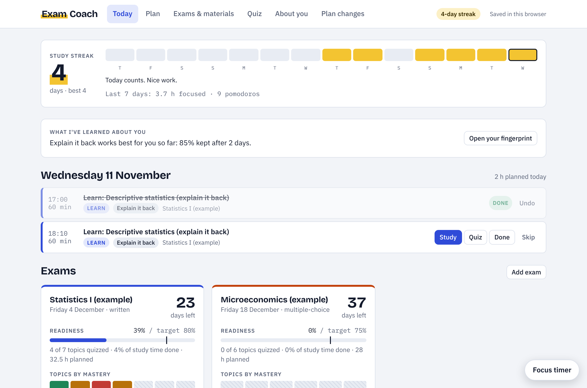
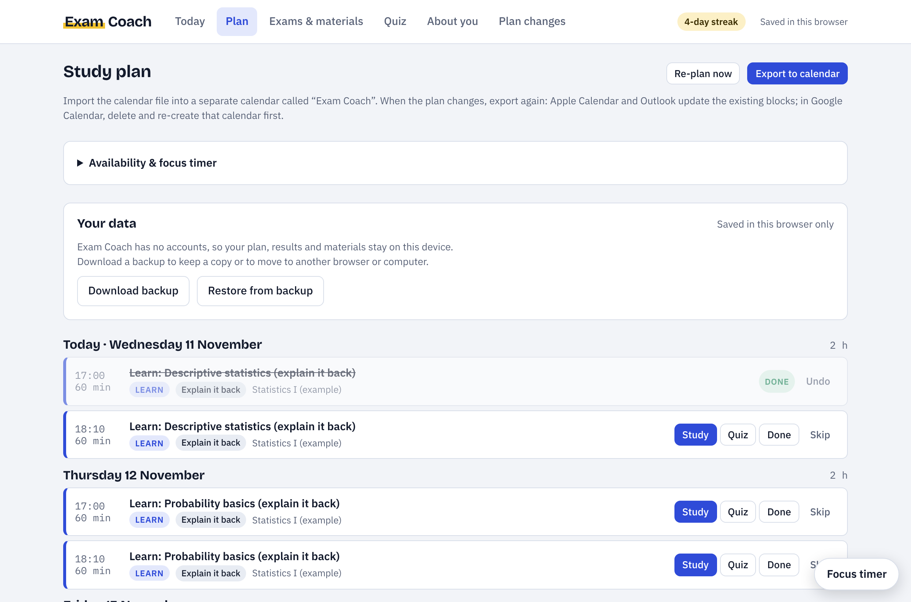
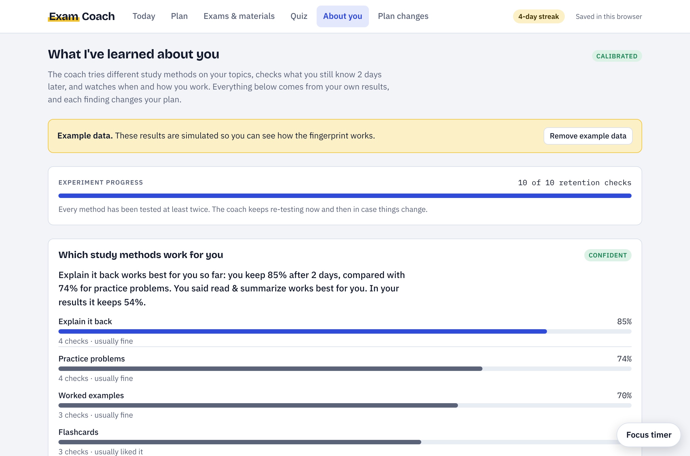
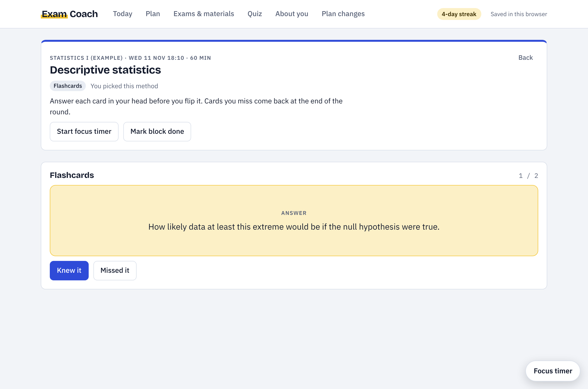
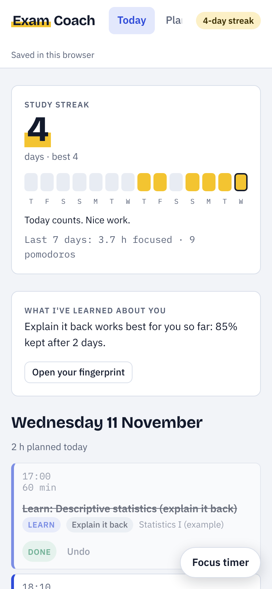

# Exam Coach

An AI study planner for university students. Upload your scripts, slides and old exams, enter your exam dates, and Exam Coach builds a study plan backwards from the exam. After each study block you take a short quiz, and if you do worse than expected, the plan changes by itself.

Over time it also learns which study methods, times of day and session lengths work best for you.



## Features

- **Plan built backwards from the exam.** Final review the day before, a mock exam before that, then learning blocks and spaced reviews spread over the days you have. Topics that appear often in old exams get more time.
- **Reads your own materials.** Upload PDFs of scripts, slides and old exams. The AI turns them into a topic list with weights, estimated hours and page references, which you can edit.
- **Quizzes in the style of your old exams.** Multiple choice, short answers and calculations, graded by the AI with feedback on what was missing.
- **A plan that adapts.** A low quiz score adds study time for that topic, schedules a review for the next day and focuses the next quiz on what you got wrong. Skipped blocks are rescheduled. Every change is logged with its reason.
- **Study sessions.** Each learning block opens a session made from your material: practice problems, worked examples, flashcards, or writing an explanation or summary that the AI checks.
- **Learning profile.** The app tries different study methods on different topics and checks two days later what you still remember. It also learns how fast you forget, when you're sharpest, how much of your plan you complete, how long you focus and whether your confidence can be trusted, and offers to adjust the plan to each finding.
- **Focus timer and streaks.** A Pomodoro timer that credits focus time to your study blocks, and a daily study streak.
- **Calendar export.** Download the plan as an `.ics` file for Google Calendar, Outlook or Apple Calendar.

| Plan | Learning profile |
|---|---|
|  |  |

| Study session | On a phone |
|---|---|
|  |  |

## Privacy

There are no accounts. Each student's plan, quiz results and uploaded materials are saved in their own browser (IndexedDB) and never stored on a server. Under **Plan → Your data**, students can download a backup file and restore it on another device.

Only the text needed for an AI request is sent to the backend. The backend stores nothing and passes the request to the Anthropic API, which handles it under Anthropic's data policy. The site loads no external fonts, scripts or trackers.

## How it works

```
index.html                     page structure
assets/app.js                  the whole app: planner, quizzes, learning profile, storage
assets/styles.css              styles, with light and dark theme
assets/fonts/, fonts.css       self-hosted fonts
assets/vendor/pdfjs/           PDF text extraction (pdf.js)
netlify/edge-functions/ai.js   AI backend: forwards requests to the Anthropic API
netlify.toml                   Netlify settings and security headers
tests/app.test.mjs             end-to-end tests
```

The front end is plain HTML, CSS and JavaScript with no build step. The only server-side code is the small AI backend at `/api/ai`. It keeps the API key secret, streams the AI's answer back to the page and can be protected with an access code.

## Getting started

### Requirements

- An Anthropic API key from [console.anthropic.com](https://console.anthropic.com). Set a monthly spend limit there under Billing.
- Node.js 20 or newer, for running it locally and for the tests.

### Run it locally

```bash
npm install
cp .env.example .env      # then put your API key into .env
npm run dev               # starts the site with the AI backend (Netlify CLI)
```

Opening `index.html` directly in a browser also works for planning, the timer, streaks and the example data, but the AI features stay off without the backend.

### Deploy on Netlify

The site runs on [Netlify](https://www.netlify.com), which serves the page and runs the AI backend. (GitHub Pages can't run the backend, so the AI features wouldn't work there.)

1. Sign up at Netlify with your GitHub account.
2. Choose **Add new project → Import an existing project → GitHub** and select this repository. Leave all build settings empty and click **Deploy**.
3. Go to **Project configuration → Environment variables** and add `ANTHROPIC_API_KEY` (your API key) and, optionally, `ACCESS_CODE`.
4. Go to **Deploys → Trigger deploy → Deploy project** so the new variables are used.
5. Open your site's address (something like `your-name.netlify.app`). Under **Exams & materials**, the button "Analyze materials with AI" should now be active.

From then on, every push to GitHub updates the site automatically.

### Configuration

| Variable | Default | Meaning |
|---|---|---|
| `ANTHROPIC_API_KEY` | required | Your Anthropic API key. |
| `ACCESS_CODE` | none | If set, the AI features only work after entering this code, so strangers who find the link can't use your credit. |
| `ANTHROPIC_MODEL` | `claude-sonnet-5-5` | Model for analysing materials, quizzes, grading and study sessions. |
| `ANTHROPIC_MODEL_QUICK` | `claude-haiku-5-5` | Model for short requests. |

## Tests

```bash
npm install
npx playwright install chromium
npm test
```

The tests open the real page in Chromium with the site's security headers and run through the main features: building a plan, uploading and reading a PDF, generating and grading a quiz, study sessions, the learning profile, calendar export, backup and restore, and the access code. The AI backend runs for real; only the Anthropic API is replaced by a fake, so no API key is needed. GitHub Actions runs the tests on every push.

## Credits

- Fonts: [Bricolage Grotesque](https://github.com/ateliertriay/bricolage), [IBM Plex Sans and IBM Plex Mono](https://github.com/IBM/plex), via [Fontsource](https://fontsource.org), SIL Open Font License 1.1. Licence files are in `assets/fonts/`.
- PDF reading: [pdf.js](https://github.com/mozilla/pdf.js) by Mozilla, Apache License 2.0. Licence file in `assets/vendor/pdfjs/`.

## Team

Built by [team members] for [course name], [university], 2026.

## License

[MIT](LICENSE)
